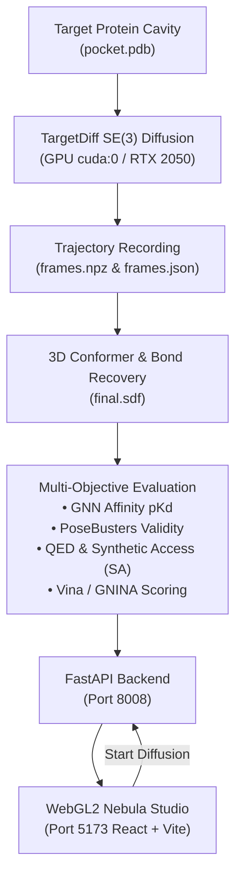

# PocketLig Workspace

> **Pocket-Conditioned 3D Generative SE(3) Diffusion, Interaction GNN Affinity ($pK_d$) Scoring, and WebGL2 Molecular Studio**

[](https://www.python.org/downloads/)
[](https://pytorch.org/)
[](https://fastapi.tiangolo.com/)
[](https://react.dev/)
[](https://threejs.org/)
[](LICENSE)

---

## Overview

**PocketLig** is an end-to-end computational drug discovery platform that bridges 3D deep generative models with real-time interactive structural biology. Given a target protein binding pocket, PocketLig samples novel, drug-like molecular ligands in 3D Euclidean space using SE(3)-equivariant continuous diffusion, scores their binding affinities with an interaction Graph Neural Network (GNN), verifies physical validity with PoseBusters and AutoDock Vina, and renders full denoising trajectories inside a custom WebGL2 raymarching studio.



---

## Key Highlights

- **GPU Diffusion-in-the-Loop**: Run real SE(3) denoising diffusion jobs on local NVIDIA GPUs (e.g. RTX 2050) directly from the web browser. Watch denoising steps progress from random Gaussian clouds into chemically bonded ligands.
- **Persistent Conformer Storage**: Every sampled molecule is automatically reconstructed into 3D SDF structures (`final.sdf`) and trajectory keyframes (`frames.json`), maintaining synchronization between target catalogs, candidate counts, and analytical properties.
- **High-Performance WebGL2 Engine ("Nebula")**: Built from the ground up with analytical raymarched capsule bonds, solvent-excluded surfaces (SES), electrostatic potential coloring, and cinematic lighting controls.
- **Independent Benchmark Rigor**: Trained on PDBbind refined set with strict leakage-controlled temporal/cluster splits that strictly isolate CASF-2016 and PoseBusters benchmark targets.
- **Comprehensive Physicochemical Profiling**:
  - Predicted Binding Affinity ($pK_d$) via PyG Interaction GNN
  - Quantitative Estimate of Drug-likeness (QED)
  - Synthetic Accessibility Score (SA)
  - PoseBusters chemical validity and steric clash detection
  - Distance-based hydrogen bond and hydrophobic interaction candidates

---

## Interactive Web Studio

The web application provides a responsive, scientific dashboard with four dedicated views:

1. **3D Molecular Studio (`Explore`)**:
   - 3D protein pocket cavity + generated ligand rendering.
   - Interactive denoising trajectory player: scrub through time, adjust frame rate, or loop diffusion dynamics.
   - Layer toggles: Protein Surface, Cavity Grid, Ligand Conformer, Hydrogen Bonds, and Trajectories.
   - 2D chemical structure viewer powered by RDKit WASM with atom-by-atom hover inspection.
   - 3D Conformer Inspector with live interaction table detailing hydrogen-bonding donor/acceptor pairs and residue distances.

2. **De Novo Ligand Generator (`Generate`)**:
   - Configure target protein, sample count (1–20), diffusion steps, sampling temperature, and seed.
   - Real-time GPU progress tracking with step-by-step progress bar and status feedback.
   - One-click "Inspect Candidate" to instantly load the newly generated ligand into the 3D viewport.

3. **Multi-Objective Analytics (`Analyze`)**:
   - Affinity ($pK_d$) vs. Drug-likeness (QED) interactive scatter plot.
   - Synthetic Accessibility and Molecular Weight distributions.
   - Pareto frontier filtering and candidate ranking.

4. **Target Benchmark Library (`Library`)**:
   - Curated reference targets from RCSB PDB with live ligand counts, resolution, organism, and direct PDB downloads.

---

## Precomputed Target Benchmarks

PocketLig includes pre-evaluated candidate ensembles across 10 benchmark targets:

| Target ID | Target Name | Class | Organism | Resolution | Ligands Available |
| :---: | :--- | :--- | :--- | :---: | :---: |
| **`1HVR`** | HIV-1 Protease | Protease | HIV-1 | 2.00 Å | 11 |
| **`5R84`** | SARS-CoV-2 Main Protease | Cysteine Protease | SARS-CoV-2 | 1.27 Å | 11 |
| **`3ERK`** | Mitogen-Activated Kinase 1 (ERK2) | Kinase | *H. sapiens* | 2.40 Å | 10 |
| **`1FIN`** | Cyclin-Dependent Kinase 2 (CDK2) | Kinase | *H. sapiens* | 2.05 Å | 10 |
| **`1ERR`** | Estrogen Receptor Alpha | Nuclear Receptor | *H. sapiens* | 3.10 Å | 12 |
| **`1STP`** | Streptavidin | Binding Protein | *S. avidinii* | 2.60 Å | 10 |
| **`1XAP`** | Carbonic Anhydrase II | Lyase | *H. sapiens* | 1.50 Å | 10 |
| **`2RGP`** | Aurora Kinase A | Kinase | *H. sapiens* | 3.50 Å | 10 |
| **`4F3C`** | Tyrosine-Protein Kinase ABL1 | Kinase | *H. sapiens* | 1.95 Å | 10 |
| **`4RLU`** | Tankyrase-2 | Transferase | *H. sapiens* | 2.30 Å | 10 |

---

## Directory Structure

```
PocketLig_Workspace/
├── pocketlig/
│   ├── src/
│   │   └── pocketlig/
│   │       ├── api/               # FastAPI service (endpoints, background GPU tasks)
│   │       ├── data/              # PDBbind index parsing, split generation, PyG graphs
│   │       ├── models/            # Interaction GNN architecture and training routines
│   │       ├── generation/        # Trajectory I/O, frame selection, and 3D reconstruction
│   │       ├── eval/              # Multi-objective scoring (GNN pKd, PoseBusters, QED)
│   │       ├── precompute/        # PDB preparation and electrostatics pipelines
│   │       └── properties.py      # Lipinski metrics, RDKit descriptors, and H-bond detection
│   ├── web/                       # React 18 + TypeScript + Vite frontend
│   │   ├── src/
│   │   │   ├── App.tsx            # Main layout, studio controls, generation form
│   │   │   ├── nebula.ts          # Custom WebGL2 shader & raymarching viewer
│   │   │   ├── Structure2D.tsx    # RDKit WASM 2D molecular layout
│   │   │   ├── Conformer.tsx      # 3D conformer viewer & residue contact inspector
│   │   │   ├── api.ts             # Typed REST client for FastAPI backend
│   │   │   └── styles.css         # Dark / light responsive UI theme
│   │   ├── index.html
│   │   └── package.json
│   ├── scripts/                   # Sampling automation, evaluation, batch generators
│   │   ├── targetdiff_sample_pocket.py
│   │   └── generate_all_targets.sh
│   ├── artifacts/                 # Precomputed targets, manifests, PDBs, metrics, and SDFs
│   ├── runs/                      # Trained model checkpoints (best.pt)
│   ├── Makefile                   # Service shortcuts (make api, make dev, etc.)
│   └── requirements.txt           # Python dependencies
├── targetdiff/                    # TargetDiff SE(3) diffusion submodule
│   ├── models/                    # Equivariant score network (ScorePosNet3D)
│   ├── utils/                     # Reconstruction, coordinates, and featurizers
│   └── configs/                   # Sampling and architecture YAML configurations
├── fast_pipeline.sh               # One-touch end-to-end preprocessing script
└── README.md                      # Platform documentation
```

---

## Getting Started

### 1. Prerequisites

- **OS**: Linux (Ubuntu 20.04+ recommended)
- **GPU**: NVIDIA GPU with CUDA 11.8+ or 12.0+ (minimum 4 GB VRAM)
- **Node.js**: v18+ and npm v9+
- **Python**: 3.10 or 3.11 with Conda

### 2. Environment Setup

Create the conda environment for GPU diffusion and PyTorch Geometric:

```bash
# Clone the repository
git clone --recurse-submodules https://github.com/Abhin-Krishna-MP/PocketLig_Workspace.git
cd PocketLig_Workspace

# Create conda environment with PyTorch & CUDA
conda create -n pocketforge python=3.10 -y
conda activate pocketforge

# Install PyTorch with CUDA support
pip install torch torchvision --index-url https://download.pytorch.org/whl/cu118

# Install PyTorch Geometric dependencies
pip install torch_geometric torch_scatter torch_sparse -f https://data.pyg.org/whl/torch-2.1.0+cu118.html

# Install chemoinformatics and evaluation packages
pip install rdkit openbabel-wheel biopython posebusters fastapi uvicorn scipy tqdm
```

### 3. Launching the Services

#### Terminal 1: FastAPI Backend (Port 8008)
```bash
cd pocketlig
POCKETLIG_ARTIFACTS=artifacts python -m uvicorn pocketlig.api.main:app --host 127.0.0.1 --port 8008
```

#### Terminal 2: React Web Studio (Port 5173)
```bash
cd pocketlig/web
npm install
npm run dev -- --host 127.0.0.1 --port 5173
```

Open your browser and navigate to **`http://localhost:5173`**.

---

## REST API Reference

The backend exposes a clean, typed REST interface on port `8008`:

| Method | Endpoint | Description |
| :--- | :--- | :--- |
| `GET` | `/targets` | List all available targets, metadata, and ligand counts |
| `GET` | `/targets/{tid}` | Fetch `manifest.json` for a specific target |
| `GET` | `/targets/{tid}/pocket` | Get residue count, atom coordinates, centroid, and cutoff |
| `GET` | `/targets/{tid}/molecules` | Fetch all evaluated molecules sorted by affinity or QED |
| `POST`| `/targets/{tid}/generate` | Submit a real GPU diffusion sampling job (`cuda:0`) |
| `GET` | `/jobs/{job_id}` | Poll generation job progress, current diffusion step, and status |
| `GET` | `/targets/{tid}/molecule/{mol}/final.sdf` | Download or stream the 3D SDF conformer |
| `GET` | `/targets/{tid}/trajectory/{mol}` | Fetch 50-step coordinate trajectory (`frames.json`) |
| `GET` | `/targets/{tid}/molecule/{mol}/properties` | Compute Lipinski Rule-of-Five, LogP, MW, TPSA, HBD, HBA |
| `GET` | `/targets/{tid}/molecule/{mol}/contacts` | Detect distance-based hydrogen bonds and residue contacts |

---

## CLI Usage

### Sampling Ligands from the Command Line
```bash
cd targetdiff
PYTHONPATH=../pocketlig/src:. python ../pocketlig/scripts/targetdiff_sample_pocket.py \
    configs/sampling.yml \
    --pdb_path ../pocketlig/artifacts/1hvr/pocket.pdb \
    --out_dir ../pocketlig/artifacts/1hvr/trajectories \
    --num_samples 5 \
    --num_steps 20 \
    --device cuda:0
```

### Evaluating Generated Candidates
```bash
cd pocketlig
python -m pocketlig.eval.run_eval \
    --sdf_dir artifacts/1hvr/trajectories \
    --pocket artifacts/1hvr/pocket.pdb \
    --gnn runs/gnn_s0/best.pt \
    --out artifacts/1hvr/metrics.json
```

---

## License

This project is licensed under the [MIT License](LICENSE).

## Acknowledgments

- **TargetDiff**: Guan et al., *3D Equivariant Diffusion for Target-Aware Molecule Generation and Affinity Prediction*, ICLR 2023.
- **PoseBusters**: Buttenschoen et al., *PoseBusters: AI-based docking methods fail to generate physical valid poses*, Chemical Science 2024.
- **RDKit**: Open-source cheminformatics and machine learning toolkit.
